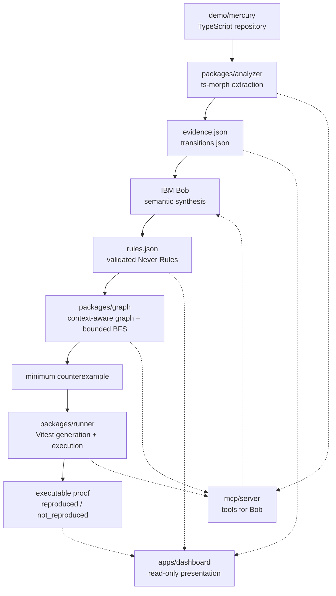

# NeverGraph

**The Negative Specification Compiler**

> Recover what your software has learned must never happen.
> Prove every new change still can't make it happen.

NeverGraph uses IBM Bob to recover latent *negative* invariants from repository
evidence, compiles them into machine-evaluable forbidden behavioral conditions,
and then deterministically proves whether a future code change makes one
reachable — producing a minimum counterexample and an executable regression test
when it does.

**DISCOVER → COMPILE → PROVE**

---

## The Problem

Every mature repository carries two specifications.

The first one is written down: what the software *should* do. Requirements,
tickets, happy-path tests.

The second one is almost never written down: everything years of incidents,
bug fixes and code review have taught the system it must **never** be able to
do. That knowledge does not disappear — it gets scattered across the codebase as:

- guard clauses that throw on a forbidden transition,
- negative tests asserting an operation must fail,
- error classes raised at state boundaries,
- state transitions that deliberately have no inverse,
- historical facts preserved on a record long after they stop being "current".

Nobody owns that second specification. It exists only as a pattern distributed
across hundreds of files, and no artifact states it.

So when someone ships a reasonable new feature months later, a behavior that was
previously impossible can quietly become reachable — **while every existing test
still passes**, because no test was ever written for a state nobody thought could
exist.

## The Idea

| | |
|---|---|
| **Positive specification** | what the software should do |
| **Negative specification** | what the software must never be able to do |

NeverGraph recovers the second one, then compiles it into something a machine can
actually check.

A recovered rule is not prose. It is a `ForbiddenCondition` the graph engine
evaluates directly:

```json
{ "targetState": "SHIPPED", "requiredFacts": { "refundedAt": true } }
```

Any reachable state matching that condition is a proven violation.

## How It Works

```
TypeScript repository
   → ts-morph analyzer            deterministic AST extraction
   → structured evidence          guards, throws, negative tests, transitions
   → IBM Bob semantic synthesis   latent negative invariants, with reasoning
   → validated Never Rules        Zod-checked, evidence-backed, persisted
   → context-aware behavior graph nodes are (status, facts) tuples
   → bounded BFS                  reachability of the forbidden condition
   → minimum counterexample       shortest violating transition sequence
   → generated Vitest regression  the counterexample as an executable test
   → deterministic re-verification same test, re-run after the repair
```

The split is deliberate:

- **IBM Bob does the reasoning** — reading evidence and synthesizing what the
  repository has implicitly learned is forbidden.
- **Deterministic packages do the computation** — AST extraction, graph search,
  test generation and execution. No LLM decides whether a state is reachable.

### Why "context-aware" matters

Graph nodes are `(status, facts)` tuples, not status strings.

`PAID { paidAt }` and `PAID { paidAt, refundedAt, cancelledAt }` are the *same*
lifecycle status but genuinely different states. Collapse them into `"PAID"` and
the violation below becomes invisible — which is exactly why this class of bug
survives ordinary review.

## Golden Demo

IBM Bob read the analyzer's evidence for the demo repository (`demo/mercury`) and
recovered five latent negative invariants. The golden one:

> **NEVER-005** — *A refunded order must never be shipped.*
> Confidence: high. Evidence: `ev-013` (negative test), `ev-026` (guard),
> `ev-027` (throw).

Nobody told Bob this rule existed. There is no `NEVER-005` string anywhere in the
source it analyzed.

**Baseline — the repository as shipped**

```
NEVER-005   UNREACHABLE      6 states explored, depth ≤ 10
```

**Changed — a "Support Restore" feature is added**

A support agent needs to un-cancel an order, so `restoreOrder()` is added:
`CANCELLED → PAID`. It is guarded (only a cancelled order can be restored) and
it ships with its own passing tests. **The entire existing suite stays green.**

```
NEVER-005   FOUND            11 states explored, depth 5

minimum counterexample:
  1. payOrder()      CREATED   → PAID       +paidAt
  2. refundOrder()   PAID      → REFUNDED   +refundedAt
  3. cancelOrder()   REFUNDED  → CANCELLED  +cancelledAt
  4. restoreOrder()  CANCELLED → PAID           ← re-enters a shippable status
  5. shipOrder()     PAID      → SHIPPED    +shippedAt

forbidden state reached: SHIPPED { refundedAt: true }
```

`restoreOrder` never checked `refundedAt`, because when it was written there was
no reason to — the refund fact was simply carried along.

**Executable proof**

NeverGraph generates the counterexample as a real Vitest file and runs it:

```
demo/mercury/tests/regression/NEVER-005.spec.ts
REPRODUCED    testResult: fail    exit 1
```

The forbidden path completed without throwing. This is a demonstrated violation,
not a static prediction.

**Repaired — one guard added to `restoreOrder`**

```ts
if (order.refundedAt !== null) {
  throw new InvalidOrderTransitionError(/* Refunded orders cannot be restored */);
}
```

```
NEVER-005   UNREACHABLE      6 states explored
same generated regression: PASS / NOT_REPRODUCED    exit 0
```

The `PAID` state carrying a historical refund is no longer constructible, so the
forbidden `SHIPPED` state has no path into it.

## Why This Is Different

**NeverGraph discovers the rule before it discovers the bug.**

It does not start from a failure, a stack trace, or a diff. It starts from what
the repository already knows, turns that into an explicit negative specification,
and then asks whether a change violated it.

That ordering is what makes the result meaningful: the rule was recovered from
evidence that predates the change, so finding a violation is not hindsight
pattern-matching — it is a previously implicit constraint being checked for the
first time.

The output is a **minimum counterexample** and an **executable proof**, not a
severity score or a suggestion to review.

## IBM Bob

IBM Bob is a core part of how this project was built and how the product works.

**Bob's role in the product**

- **Semantic invariant recovery** — Bob reads structured analyzer evidence and
  synthesizes candidate `NeverRule` objects, including the reasoning for each.
  All five rules in `.nevergraph/rules.json` came from Bob, grounded in evidence
  ids — not from a hardcoded list.
- **Bob Skill** — [`.bob/skills/nevergraph/SKILL.md`](.bob/skills/nevergraph/SKILL.md)
  encodes the non-negotiable rules for that reasoning: evidence before invariant,
  multiple independent signals before high confidence, and a hard ban on claiming
  reachability from natural language alone. Reachability is *only* ever
  established by the BFS engine.
- **MCP integration** — [`mcp/server/`](mcp/server) exposes the deterministic
  pipeline to Bob as nine tools: `scan_repository`, `get_repository_evidence`,
  `get_transitions`, `get_never_rules`, `get_rule_evidence`,
  `submit_synthesized_rules`, `find_counterexample`, `run_witness` and
  `verify_rule`. Configured via [`.bob/mcp.json`](.bob/mcp.json).

**Bob's role in building the project**

Architecture planning and PRD audit, the Mercury baseline implementation, the
ts-morph analyzer implementation, the Bob Skill itself, negative-invariant
synthesis, and MCP integration work. Written session evidence is preserved in
[`bob_sessions/`](bob_sessions):

| Session | Evidence |
|---|---|
| Architecture planning | [`01_architecture_planning.md`](bob_sessions/01_architecture_planning.md) |
| Mercury safe baseline | [`02_mercury_safe_baseline.md`](bob_sessions/02_mercury_safe_baseline.md) |
| Repository analyzer | [`03_repository_analyzer.md`](bob_sessions/03_repository_analyzer.md) |
| Invariant synthesis + MCP | [`04_invariant_synthesis_mcp.md`](bob_sessions/04_invariant_synthesis_mcp.md) |

### What Bob did not do

To be precise about attribution: **the final repair to `restoreOrder` was not
authored by IBM Bob.** The hackathon Bob budget was exhausted before that step,
and the minimal one-guard repair was applied manually.

What the project genuinely demonstrates is that **NeverGraph verified the
repair**: the same generated regression test that reproduced the violation was
re-run against the repaired code and passed, and the bounded search reported the
forbidden state unreachable again. The verification loop is real and
deterministic; the authorship of that one guard is not Bob's.

The dashboard reflects this — it says *"Repair applied"* and *"repair verified"*,
never *"repaired by Bob"*.

## Architecture



Shared Zod contracts in `packages/schemas` sit between every stage — no package
passes unvalidated data to another, and anything Bob produces must pass schema
validation before the graph engine will consume it.

## Repository Structure

```
apps/dashboard/       Next.js dashboard — reads .nevergraph/ JSON, read-only
packages/schemas/     Shared Zod contracts — zero dependencies, built first
packages/analyzer/    ts-morph static analysis → evidence + transitions
packages/graph/       Context-aware graph engine + bounded BFS → witness
packages/runner/      Witness → Vitest file generation + execution
mcp/server/           MCP server wrapping the deterministic packages for Bob
demo/mercury/         Synthetic demo repository — the analysis TARGET
.bob/                 Bob Skill, agent rules, and MCP configuration
.nevergraph/          Captured artifacts: evidence, transitions, rules, scenarios
bob_sessions/         IBM Bob task-session evidence
docs/                 PRD, demo script, submission copy
scripts/              Scenario capture tooling
```

## Run Locally

Requires Node.js 20+ and pnpm 10.

```bash
pnpm install
```

**Build everything** (schemas first, in dependency order):

```bash
pnpm build
```

**Run the full test suite:**

```bash
pnpm test
```

**Run every package's own suite** (includes the dashboard and Mercury):

```bash
pnpm -r test
```

**Analyze the demo repository** — regenerates `.nevergraph/evidence.json` and
`.nevergraph/transitions.json` from `demo/mercury` (requires `pnpm build` first):

```bash
pnpm analyze:mercury
```

**Validate the recovered Never Rules** against the Zod contracts,
evidence references, and confidence policy:

```bash
node validate-rules.mjs
```

**Run the dashboard:**

```bash
pnpm --filter @nevergraph/dashboard dev
```

Then open <http://localhost:3000>. Scenarios can be selected in the UI or by
query parameter: `?scenario=baseline`, `?scenario=changed`, `?scenario=repaired`.

**Typecheck the workspace:**

```bash
pnpm typecheck
```

### Using NeverGraph from IBM Bob

Build the MCP server, then point Bob at this project — [`.bob/mcp.json`](.bob/mcp.json)
registers the `nevergraph` server and [`.bob/skills/nevergraph/SKILL.md`](.bob/skills/nevergraph/SKILL.md)
activates the workflow skill.

```bash
pnpm --filter @nevergraph/mcp-server build
```

## Demo Data

The dashboard renders **real captured deterministic artifacts**, not mocked
analytics.

Each of `.nevergraph/scenarios/{baseline,changed,repaired}.json` was produced by
[`scripts/capture-nevergraph-scenario.mjs`](scripts/capture-nevergraph-scenario.mjs),
which runs the actual BFS engine against the actual transition table and embeds
the real search result, graph, witness and runner execution summary.

The dashboard reads those files, validates them with the same Zod contracts the
pipeline uses, and renders them. It never calls the analyzer and never invents a
number — a malformed artifact fails the build rather than rendering a
plausible-looking value.

## Limitations

Stated plainly, because the claims above only mean something if the boundaries
are clear.

- **Bounded behavioral exploration, not formal verification.** "Unreachable"
  means exhaustive over the *extracted* transition table within the stated bounds
  (depth ≤ 10, ≤ 10,000 visited states). It is not a mathematical proof about the
  program.
- **Constrained TypeScript grammar.** The analyzer targets a specific MVP syntax
  set for status assignments, guards and negative tests. Unsupported constructs
  (`||` guard chains, negated nested expressions, truthy/falsy property guards,
  await-based negative-test expressions) are safely ignored rather than guessed —
  so evidence can be *missed*, but it is not fabricated.
- **Test generation uses a domain adapter.** Turning a witness into a runnable
  Vitest file currently goes through `packages/runner/src/adapters/mercury.ts`.
  Generalizing this to arbitrary repositories is not done.
- **Single controlled demo domain.** Mercury is a synthetic commerce repository
  built to make this class of violation demonstrable. NeverGraph has not been run
  against a large real-world codebase.
- **Read-only dashboard.** It presents captured results; it does not trigger
  analysis.
- **The Phase 6 repair was applied manually**, not authored by Bob — see
  [What Bob did not do](#what-bob-did-not-do).

## Tech Stack

TypeScript 5.8 · pnpm workspaces · Zod 4 · ts-morph 24 · Vitest 3 ·
Next.js 15 · React 19 · Tailwind CSS 4 · @xyflow/react 12 · lucide-react ·
Model Context Protocol SDK 1.30

## Hackathon

Built for the **IBM Bob 2.0 Hackathon 2026**.

- Demo narration script: [`docs/DEMO_SCRIPT.md`](docs/DEMO_SCRIPT.md)
- Submission copy: [`docs/SUBMISSION.md`](docs/SUBMISSION.md)
- Product requirements: [`docs/PRD.md`](docs/PRD.md)
- Implementation plan: [`nevergraph-plan.md`](nevergraph-plan.md)
